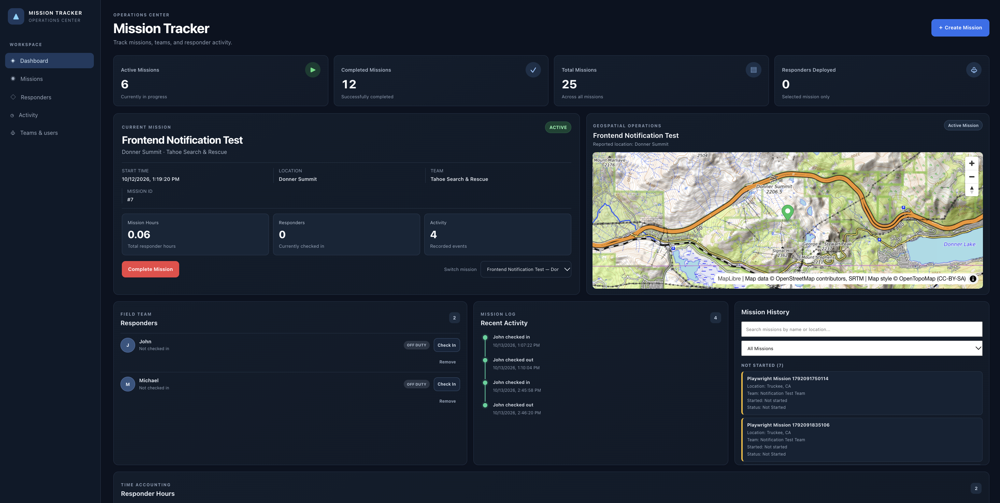

# Mission Tracker



[](https://github.com/mcariello1/mission_tracker/actions/workflows/ci.yml)

**A full-stack mission management application for coordinating search-and-rescue operations, tracking responder participation, and visualizing missions geographically.**

**Status:** Active development — core functionality implemented, automated testing and CI established.

## Overview

Mission Tracker is a portfolio project demonstrating full-stack software engineering, relational database design, REST API development, automated testing, and continuous integration.

The application models operational workflows commonly found in search-and-rescue environments, including mission activation, team assignments, responder check-in/check-out, participation tracking, and mission history.

The project emphasizes maintainability, testing, data integrity, and iterative development.

## Engineering Highlights

- **Data integrity:** Prevent duplicate active responder check-ins using
  database constraints and backend validation.
- **Mission lifecycle:** Manage mission creation, activation, completion,
  and historical records.
- **Responder participation:** Track check-in/check-out sessions and
  calculate recorded mission hours.
- **REST API:** Connect a React frontend to a FastAPI backend backed by
  PostgreSQL.
- **Geospatial workflows:** Select and persist mission coordinates on an
  interactive topographic map.
- **Automated verification:** Test backend behavior with pytest and browser
  workflows with Playwright.
- **Continuous integration:** Run backend tests, frontend quality checks,
  production builds, and browser tests through GitHub Actions.

## Technology Stack

| Layer | Technologies |
|---|---|
| Frontend | React, JavaScript, Vite, CSS |
| Backend | Python, FastAPI |
| Database | PostgreSQL |
| Mapping | MapLibre GL JS |
| Backend Testing | pytest |
| End-to-End Testing | Playwright |
| Code Quality | Ruff, Oxlint, Prettier |
| Continuous Integration | GitHub Actions |

## Getting Started

### Prerequisites

- Python 3.12 or newer
- Node.js 22 or newer
- PostgreSQL 16 or newer
- Git

### 1. Clone the Repository

```bash
git clone https://github.com/mcariello1/mission_tracker.git
cd mission_tracker
```

### 2. Set Up the Python Backend

Create and activate a virtual environment:

```bash
python3 -m venv .venv
source .venv/bin/activate
```

Install the backend dependencies:

```bash
pip install -r requirements.txt
```

### 3. Configure PostgreSQL

Start PostgreSQL and create a development database:

```bash
createdb mission_tracker
```

Set the database connection variables to match your local PostgreSQL configuration:

```bash
export DB_NAME=mission_tracker
export DB_USER=postgres
export DB_PASSWORD=your_password
export DB_HOST=localhost
export DB_PORT=5432
```

Initialize the database from the project root:

```bash
psql -d mission_tracker -v ON_ERROR_STOP=1 -f database/schema.sql
psql -d mission_tracker -v ON_ERROR_STOP=1 -f backend/migrations/001_unique_active_checkin.sql
psql -d mission_tracker -v ON_ERROR_STOP=1 -f backend/migrations/002_mission_activity_log.sql
psql -d mission_tracker -v ON_ERROR_STOP=1 -f database/seed.sql
```

### 4. Start the Backend

From the project root:

```bash
python -m uvicorn backend.main:app --reload
```

The API will be available at:

- http://localhost:8000
- http://localhost:8000/docs — interactive FastAPI documentation

### 5. Start the Frontend

Open a second terminal:

```bash
cd frontend
npm ci
npm run dev
```

Open the local URL printed by Vite in your terminal, typically:

http://localhost:5173

### 6. Run Automated Tests

From the project root, with the test database configured:

```bash
python -m pytest backend/tests -v
```

From the `frontend` directory:

```bash
npm run lint
npx prettier --check "src/**/*.{js,jsx,css}" "tests/**/*.{js,ts}"
npm run build
npx playwright test --project=chromium
```

Playwright requires its Chromium browser installation and running test services. See the GitHub Actions workflow for the automated test environment.

### 7. Code Quality

Backend linting and formatting:

```bash
ruff check backend/
ruff format backend/ --check
```

Frontend linting, formatting, and build validation are enforced through GitHub Actions alongside backend and browser tests.

## Implemented Features

### Mission Management

- Create missions and assign teams
- Start and complete missions
- View active and completed missions
- Review mission history and activity logs

### Responder Management

- Create teams and manage assignments
- Check responders into and out of missions
- Track responder participation sessions
- Calculate cumulative mission hours
- Display currently deployed responders

### Geospatial Visualization

- Interactive topographic mapping using MapLibre GL JS
- Mission location selection and confirmation
- Persistent mission coordinates stored in PostgreSQL
- Location editing and cancellation workflows

## Testing and Quality Assurance

Automated testing is integrated into the development workflow.

**Backend testing**
- pytest integration tests
- Dedicated PostgreSQL test database
- Validation of mission lifecycle, responder operations, and API behavior

**Frontend testing**
- Playwright browser-based end-to-end tests
- Mission creation and lifecycle workflow coverage
- Dashboard functionality checks

**Code quality**
- Ruff for Python linting and formatting
- Oxlint for frontend linting
- Prettier for consistent frontend formatting
- Vite production build verification

### Continuous Integration

GitHub Actions automatically runs quality checks and automated tests on pushes and pull requests.

The pipeline provisions PostgreSQL, initializes the database, executes backend tests, validates frontend code quality, builds the React application, and runs Playwright browser tests.

Playwright test artifacts and diagnostic server logs are collected when applicable.

## Architecture and Engineering Decisions

The application separates the React frontend, FastAPI REST API, and PostgreSQL
persistence layer. Its design emphasizes data integrity, responder participation
tracking, geospatial workflows, and automated verification.

For the system diagram, data model, API responsibilities, testing strategy, and
engineering tradeoffs, see the [Architecture Documentation](docs/architecture.md).

## Engineering Approach

Mission Tracker was developed to demonstrate the process of translating operational requirements into a working software system.

My development approach emphasizes:

- Understanding requirements and operational workflows
- Designing relational data models and REST APIs
- Handling application state and asynchronous operations
- Identifying edge cases and validating behavior
- Building repeatable automated tests
- Integrating code-quality checks into CI
- Documenting architecture and engineering decisions

AI-assisted development tools are incorporated into the workflow, with technical decisions, integration, debugging, and verification remaining my responsibility.

## Roadmap

- Responder GPS positioning and location history
- Enhanced geospatial visualization
- Structured Playwright QA evidence and reporting
- AI-assisted test failure analysis
- Automated pull request code reviews
- AI-generated mission summaries with evaluation tests
- Deployment and production-readiness improvements

## Development Status

Mission Tracker is actively maintained as an engineering portfolio project. Core mission-management functionality, geospatial features, automated testing, and CI are implemented.

Additional capabilities are being developed incrementally.
