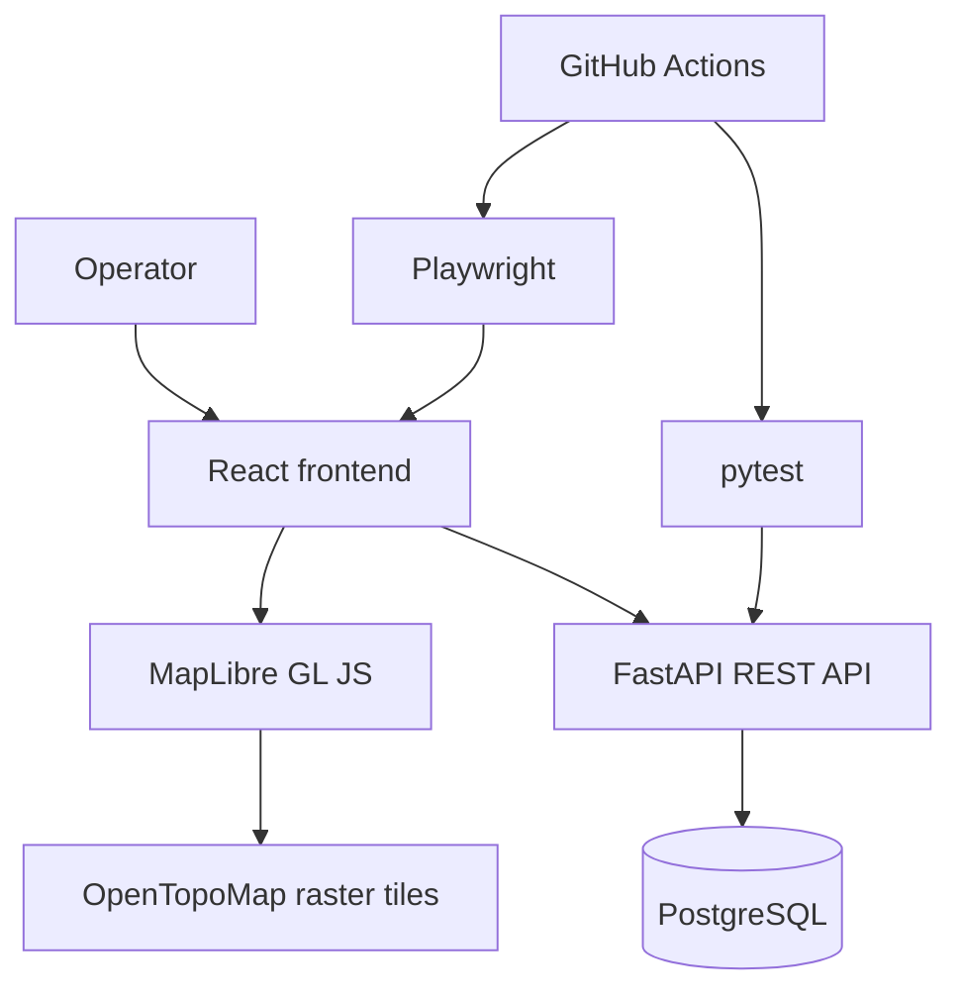

# Mission Tracker — Architecture

## 1. Overview

Mission Tracker is a full-stack mission management application designed to
coordinate search-and-rescue operations, track responder participation, and
visualize mission locations geographically.

The application separates the frontend, backend API, and relational database
to keep user interaction, application logic, and persistent data organized.

### Technology stack

| Layer | Technology | Responsibility |
|---|---|---|
| Frontend | React, JavaScript, Vite | User interface and application state |
| API | Python, FastAPI | HTTP endpoints and application workflows |
| Database | PostgreSQL | Persistent operational data and relational integrity |
| Mapping | MapLibre GL JS | Interactive topographic map |
| Backend tests | pytest | API and database behavior |
| End-to-end tests | Playwright | Browser workflows |
| CI | GitHub Actions | Automated checks and test execution |

## 2. System Architecture

The React frontend communicates with FastAPI over HTTP. The backend handles
application requests and persists data in PostgreSQL.

MapLibre renders the interactive map using raster topographic tiles. Mission
coordinates are saved through the backend so they can be retrieved with
mission data rather than existing only as temporary browser state.

The CI workflow provisions PostgreSQL, initializes the database, runs backend
tests, validates frontend code quality, builds the frontend, and executes
Playwright tests.

## 3. Data Model and Persistence

PostgreSQL stores the application's operational data. The schema is defined
in `database/schema.sql`, with additional changes tracked in
`backend/migrations/`.

### Core tables

- **`users`:** Responder records with a unique email address.
- **`teams`:** Team records.
- **`team_members`:** Many-to-many relationship between users and teams,
  with a composite primary key on `(team_id, user_id)`.
- **`missions`:** Mission records associated with a team. Each mission stores
  its name, optional location description, latitude, longitude, lifecycle
  timestamps, and creation timestamp.
- **`mission_participation`:** Responder check-in sessions, including
  check-in and optional check-out timestamps.
- **`mission_activity_log`:** Timestamped mission events, optionally
  associated with the user who performed the action.

### Relationships and integrity

Missions reference a team. Team membership references both a user and a
team. Participation records reference a mission and a user. These foreign
keys preserve referential integrity, with cascading deletes configured for
team membership, missions, and participation as defined in the schema.

The `mission_participation` table also has a check constraint requiring
`checked_out_at` to be greater than or equal to `checked_in_at` whenever a
check-out timestamp is present.

Database schema changes are version-controlled SQL files. This makes schema
initialization and migrations reviewable alongside application changes.

## 4. Mission Lifecycle

Mission management supports creation, activation, completion, and history.

The interface reflects whether a mission has not started, is active, or has
been completed. Lifecycle operations are performed through the backend, which
persists the resulting state in PostgreSQL.

Keeping lifecycle state on the server allows the application to reload mission
information without relying exclusively on the state held by an individual
browser session.

Automated tests exercise mission creation and lifecycle workflows.

## 5. Responder Participation and Hours

Responder participation is tracked through check-in and check-out sessions.

The workflow supports:

1. Checking a responder into an eligible mission.
2. Recording the active participation session.
3. Checking the responder out when participation ends.
4. Reviewing participation records and calculated mission hours.

The backend and database help protect the integrity of these operations.

### Preventing duplicate active check-ins

The migration `001_unique_active_checkin.sql` creates a partial unique index
on `(mission_id, user_id)` for rows where `checked_out_at IS NULL`.

This allows historical participation sessions while preventing the same user
from having multiple active check-in records for the same mission.

Application-level validation provides useful error handling, while the
database index enforces this invariant even if concurrent requests attempt
to create duplicate active sessions.

### Mission activity history

The migration `002_mission_activity_log.sql` introduces the mission activity
log used to record operational events.

An activity history helps users review changes over the course of a mission
rather than seeing only its current state.

### Calculating responder hours

Responder hours are derived from participation session timestamps. Completed
sessions provide the recorded start and end times used to calculate elapsed
time.

This keeps historical hour calculations tied to persisted records rather than
to a timer running in the browser.

## 6. Geospatial Workflows

MapLibre GL JS provides the interactive mapping interface, using raster
topographic tiles from OpenTopoMap.

The current location workflow supports:

- Viewing a mission on the map.
- Selecting a proposed location.
- Reviewing the proposed coordinates.
- Saving a location to the mission.
- Cancelling a proposed change without saving it.

Mission latitude and longitude are persisted through the backend. The
frontend distinguishes between a proposed map selection and the saved mission
location, so a selection is not treated as saved until the operation
succeeds.

Live responder GPS tracking and responder location history are future
enhancements, not current capabilities.

## 7. API and Frontend Responsibilities

The frontend is responsible for rendering the interface, collecting user
input, and reflecting the results of API requests.

The FastAPI backend exposes HTTP endpoints for mission operations,
participation, activity, and location updates. It validates requests and
coordinates database access.

After a successful mutation, the frontend updates or reloads the relevant
application state so displayed information reflects persisted data.

FastAPI's interactive API documentation is available at `/docs` when the
backend is running locally.

## 8. Testing Strategy

The project uses backend tests, browser-based end-to-end tests, and automated
code-quality checks.

### Backend integration tests

pytest exercises backend behavior against PostgreSQL. The CI workflow starts
a PostgreSQL service, initializes the schema, applies migrations, loads seed
data, and runs the backend test suite.

This allows tests to validate API behavior against a real relational database
rather than relying exclusively on mocked persistence.

### End-to-end browser tests

Playwright tests the application through Chromium. Current coverage includes
dashboard rendering, mission creation, and mission lifecycle workflows.

The CI workflow starts the backend and frontend services, installs Chromium,
and runs the browser tests.

### Code quality and build checks

The CI workflow includes:

- Ruff linting and formatting checks for Python.
- Frontend linting.
- Prettier formatting checks.
- A production frontend build.
- Backend and Playwright test execution.

Playwright reports and diagnostic server logs are uploaded as workflow
artifacts when applicable.

## 9. Engineering Tradeoffs

### Relational database

PostgreSQL provides structured relationships, persistent mission history, and
database constraints. This fits the application's need to associate missions,
teams, responders, and participation sessions consistently.

### Database-level integrity

The active check-in uniqueness safeguard protects an important operational
invariant at the persistence layer, rather than relying solely on frontend
validation.

### Timestamp-based participation

Recording check-in and check-out timestamps makes participation history
auditable and supports calculating elapsed mission hours from stored data.

### Raster-based mapping

Raster topographic tiles provide geographic context without requiring the
project to operate its own map-tile rendering infrastructure. The map's
external tile source does, however, require network access.

### Automated verification

Combining pytest, Playwright, linting, formatting checks, and a production
build catches different classes of problems. Backend tests validate API and
database behavior, while browser tests exercise integrated user workflows.

## 10. Current Limitations and Future Work

The current implementation focuses on mission management, responder
participation, mission history, and manual mission-location workflows.

Potential future improvements include:

- Responder GPS positioning and location history.
- Additional geospatial overlays and visualization.
- More comprehensive automated QA evidence, including screenshots and logs.
- AI-assisted pull request review and test failure analysis.
- Evaluation tests for AI-generated mission summaries.
- Deployment hardening, observability, and production-readiness improvements.

These items are planned enhancements, not claims about existing functionality.

## Summary

Mission Tracker demonstrates a full-stack application built around a React
frontend, FastAPI API, PostgreSQL persistence, geospatial visualization, and
automated verification.

The key engineering themes are persistent operational state, responder
participation records, database-backed integrity safeguards, reproducible
database initialization, and CI checks that validate both backend behavior
and browser workflows.
